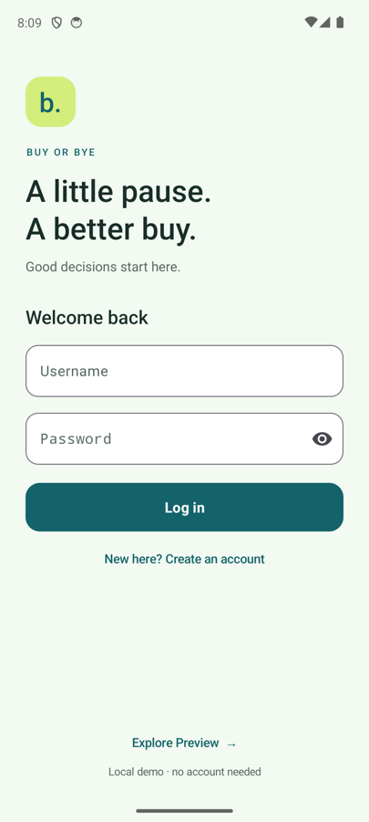
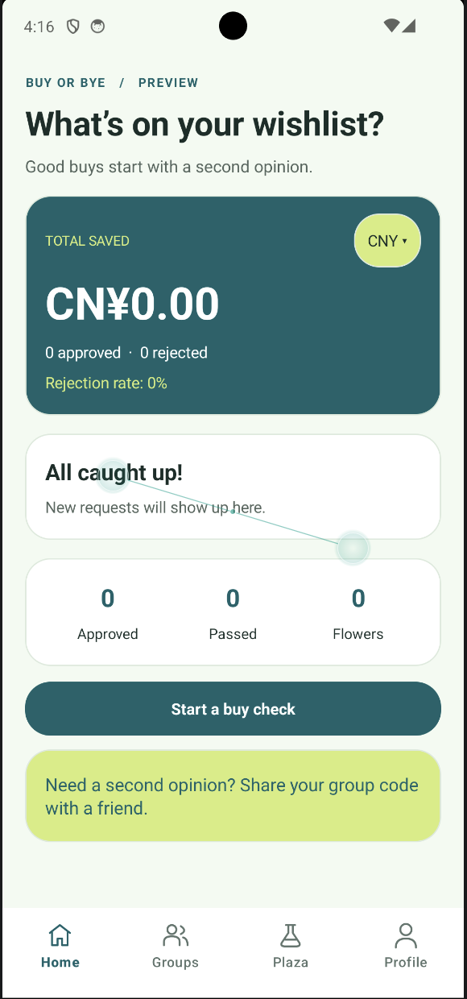
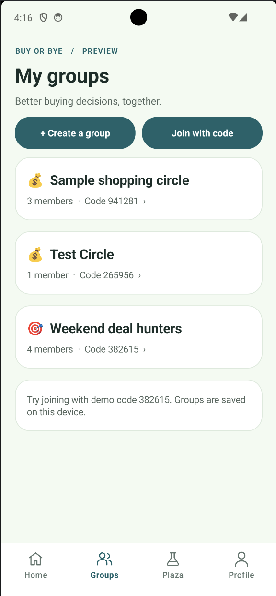
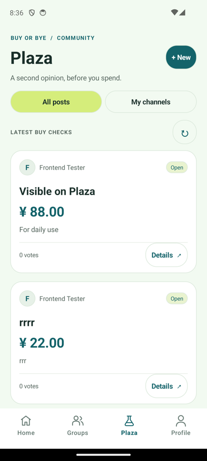
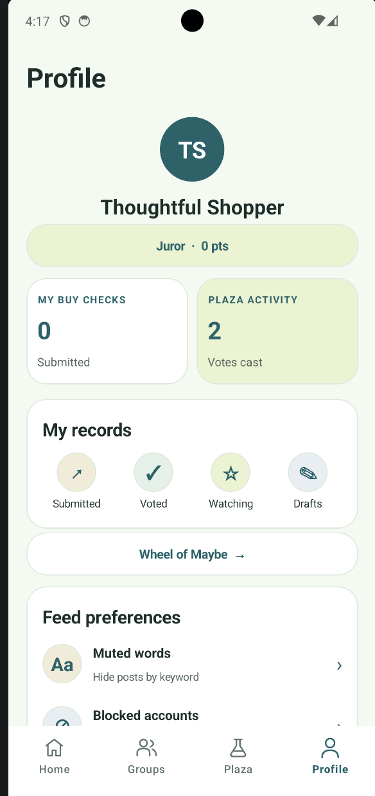

# buy or bye Android

Java Android client for purchase proposals: users share items they are unsure about buying and explain their reasons, then others vote `BUY` or `NOT_BUY` with a reason.

## Requirements

- Android Studio with Android SDK Platform 37
- JDK 17 (Android Studio's bundled JDK is suitable)
- An emulator or device running Android 7.0 (API 24) or later

## Try the Android preview

[Download the debug APK](docs/downloads/buyorbye-preview-debug.apk?raw=true) and open it on an Android 7.0+ device, or install it on a running emulator:

```sh
adb install -r docs/downloads/buyorbye-preview-debug.apk
```

This debug build supports backend login and proposal publishing, plus an explicit local Preview mode.

### Connect a backend

On the login screen, open **Server settings**, enter the API base URL or Swagger URL, and use **Test connection** before saving. For a backend on the emulator host computer, use `http://10.0.2.2:8080/api/`. For a teammate's computer or a physical phone, use a reachable LAN or deployed server address.

Register or log in to publish through the backend. The form loads available groups, channels, and tags from the server, saves a draft, then publishes it. After confirmation, **View post** opens Submitted records. Plaza and history use server pagination, refresh, and retry.

**Explore Preview** saves posts on the device and labels them as local. Other areas, including rankings and parts of Profile, still use demo data. Photo upload is pending, and the current server publishing form supports MULTI + TIME settlement.




## Local Android Studio setup

Open the repository root in Android Studio. Install Android SDK Platform 37 in SDK Manager and sync Gradle. Android Studio normally creates `local.properties` automatically. If it asks for an SDK path, create the file in the repository root and use the path shown in SDK Manager. For example, on macOS:

```properties
sdk.dir=/Users/YOUR_USERNAME/Library/Android/sdk
```

The preview was verified with an Android 14 (API 34) emulator. Use the Gradle wrapper to build with the project’s configured Gradle version.

## Run

Open this directory in Android Studio, sync Gradle, then run the `app` configuration on an emulator or device. The Android Studio project created the Gradle Wrapper, so command-line checks run with:

```sh
./gradlew test lint assembleDebug
```

The debug API URL defaults to `http://10.0.2.2:8080/api/` for the Android emulator. Use **Server settings** to select a reachable server without rebuilding. Session preferences are excluded from Android backup.

## App screenshots

| Home | Groups | Plaza | Profile |
| --- | --- | --- | --- |
|  |  |  |  |

## Structure and versions

- Application ID and Java namespace: `com.hku.money`
- Java 17, `minSdk 24`, `compileSdk 37`, `targetSdk 37`
- One Activity with four Navigation Component Fragment destinations: Home, Plaza, Groups, Profile
- AndroidX Navigation, ViewModel/LiveData, Material XML, Retrofit/OkHttp/Gson, and Room are configured
- Room is reserved for local decision-wheel data; the business schema and API models follow team review

## Team workflow

- Branch from `main` with a focused name such as `feature/proposal-list`.
- Open a Pull Request; do not push directly to `main`.
- Require one teammate approval and passing Android CI before merging.
- Follow `.editorconfig` and keep API changes coordinated with the backend repository.
- Never commit `local.properties`, credentials, signing keys, IDE state, or build directories. The linked preview APK is provided as a standalone test download.

See [CONTRIBUTING.md](CONTRIBUTING.md).

The shared system design is maintained in the [backend repository](https://github.com/SYSU-xjx/buyorbye-backend/blob/main/DESIGN.md).
