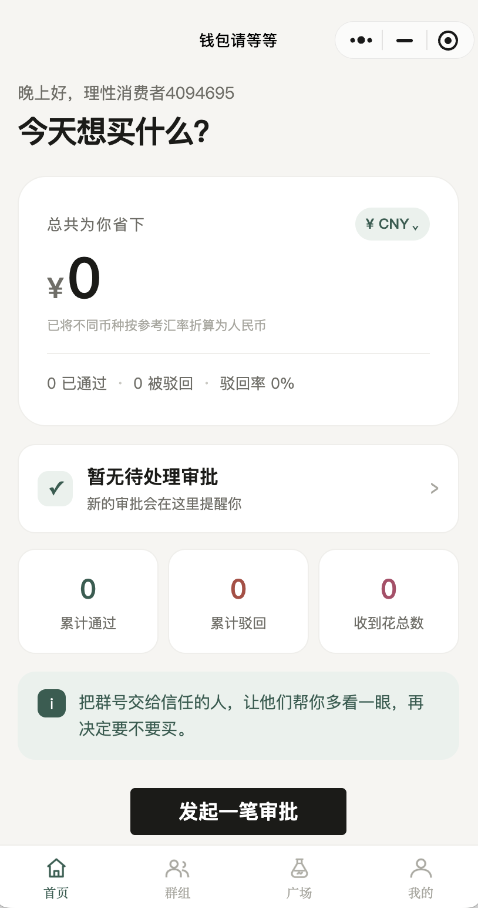
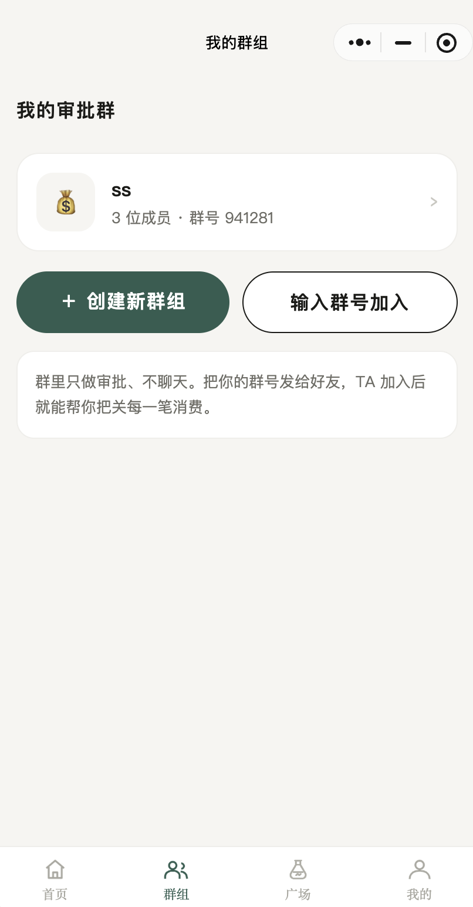
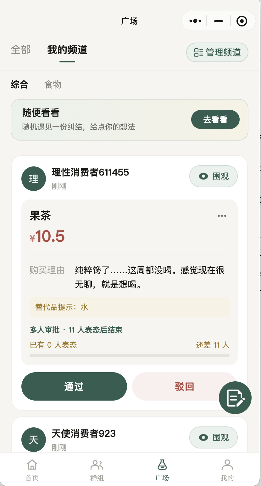
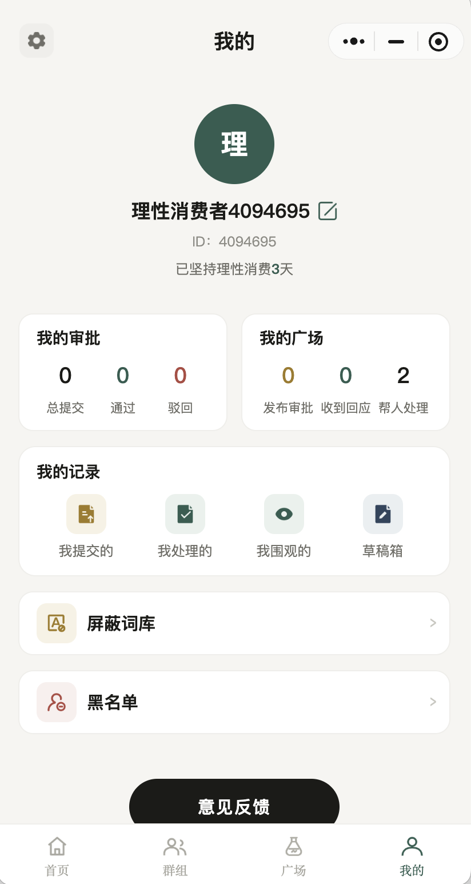
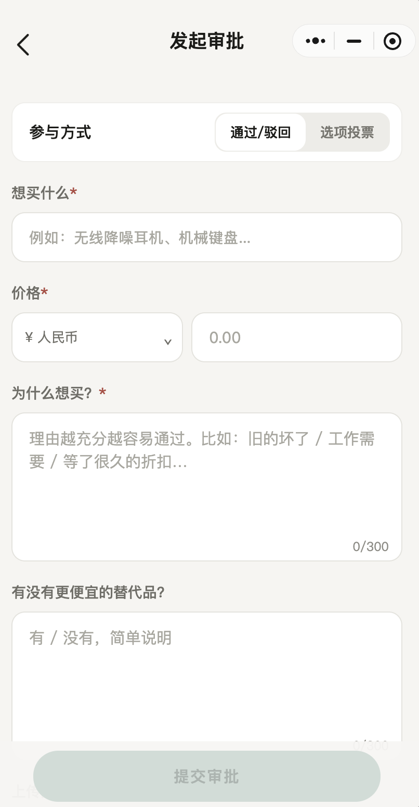
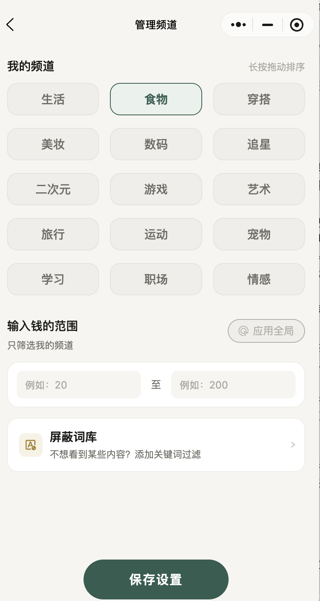
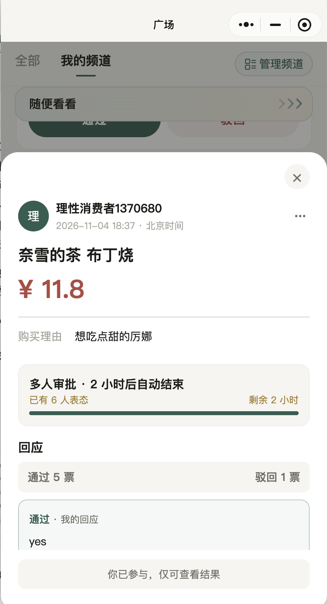

> Historical design snapshot from 2026-11-04. See README.md and QA-2026-11-18.md for the current implementation.

# Buy or Bye Android 前端设计文档

2026-11-04 · Java 17 + Fragment · 对应分支 feature/reference-screens

## 已确认决策

到截止时间后，根据最低参与人数结算。达到人数不提前结束；参与不足显示 INSUFFICIENT_PARTICIPATION。前端只展示后端结果，不自行结算。二元选择 BUY / NOT_BUY，投票理由必填。项目设计允许截止前改票，不能照搬原图“已参与仅查看”的限制。选项投票结算规则仍待确认。

## 视觉与 Android 适配

背景 #F6F5F2，白卡片，主色 #315F53，正文 #1D1E1A，驳回 #BA4942。页面边距 16dp，卡片圆角 22dp，正文 14–16sp，标题 23sp，金额 30–32sp。这些是适配起点，需真机校准。

底栏：首页、群组、广场、我的。发布和频道管理隐藏底栏，通过 Android 系统返回。保留系统栏，不复制微信胶囊；Insets 适配系统栏和键盘，内容可滚动。

## 页面设计与代码

以下图片是用户提供的参考图，不是实现运行截图。代码提供演示布局，尚未达到像素级还原。

### 首页



问候、节省金额、待处理空态、统计与发布入口。

实现：`SectionFragment.java` → `home()`

```java
    private void home() {
        title("Buy or Bye"); content.addView(text("你好，理性消费者",16,0xff777870)); heading(content,"今天想买什么？");
        LinearLayout c=card(content); c.addView(text("总共为你省下                 ¥ CNY",16,GREEN)); heading(c,"¥ 0.00");
        c.addView(text("演示金额；实际汇率与统计由后端返回",12,0xff777870)); c.addView(text("0 已通过  ·  0 被驳回  ·  驳回率 0%",14,INK));
        c=card(content); heading(c,"✓ 暂无待处理审批"); c.addView(text("连接服务后，在这里提醒你",14,0xff777870));
```

### 群组



群卡、成员数、群号、创建和加入入口；写操作待接口。

实现：`SectionFragment.java` → `groups()`

```java
    private void groups() {
        title("我的群组"); heading(content,"我的审批群"); LinearLayout c=card(content);
        heading(c,"💰 示例群组"); c.addView(text("3 位成员 · 示例群号 941281",15,0xff777870)); c.setOnClickListener(v->pending());
        button(content,"＋ 创建新群组",this::pending); button(content,"输入群号加入",this::pending);
        card(content).addView(text("群里只做审批、不聊天。把群号发给好友，一起把关每一笔消费。",15,0xff777870));
```

### 广场



提案卡、理由、金额、最低人数进度、详情和投票入口；分页与筛选未接入。

实现：`SectionFragment.java` → `plaza()`

```java
    private void plaza() {
        title("广场"); button(content,"管理频道",()->navigate(R.id.channelsFragment));
        content.addView(text("全部  /  我的频道       综合 · 食物",16,GREEN));
        button(content,"随便看看 · 查看示例提案",this::detail);
        LinearLayout c=card(content); heading(c,"理性消费者 · 示例"); c.addView(text("刚刚                                      围观 ›",14,GREEN));
```

### 我的



资料、审批与广场统计、记录入口；二级页面待补图和接口。

实现：`SectionFragment.java` → `profile()`

```java
    private void profile() {
        title("我的"); heading(content,"理性消费者 · 示例"); content.addView(text("ID：演示用户\n已坚持理性消费 3 天",16,GREEN));
        LinearLayout c=card(content); heading(c,"我的审批"); c.addView(text("0 总提交       0 通过       0 驳回",16,INK));
        c=card(content); heading(c,"我的广场"); c.addView(text("0 发布审批     0 收到回应     2 帮人处理",14,INK));
        for(String label:new String[]{"我提交的","我处理的","我围观的","草稿箱","屏蔽词库","黑名单","设置与资料编辑","意见反馈"}) button(content,label,this::pending);
```

### 发布



商品、币种、金额、理由、替代品、范围、标签、截止时间、最低人数。基础校验已实现，图片及选项投票未实现。

实现：`SectionFragment.java` → `publish()`

```java
    private void publish() {
        title("发起审批"); select("参与方式",new String[]{"通过 / 驳回","选项投票（待确定结算规则）"});
        EditText name=input("想买什么 *","例如：无线降噪耳机",false);
        select("币种",new String[]{"CNY 人民币","HKD 港币","USD 美元"}); EditText amount=input("价格 *","0.00",false); amount.setInputType(InputType.TYPE_CLASS_NUMBER|InputType.TYPE_NUMBER_FLAG_DECIMAL);
        EditText reason=input("为什么想买？ *（最多 300 字）","填写购买理由",true); reason.setFilters(new android.text.InputFilter[]{new android.text.InputFilter.LengthFilter(300)});
```

### 管理频道



复选频道、长按前移一位、金额区间及本机保存。原图三列网格在此版改为单列复选框；未实现拖动，偏好尚不影响示例列表。

实现：`SectionFragment.java` → `channels()`

```java
    private void channels() {
        title("管理频道"); content.addView(text("本机偏好演示 · 长按前移一位排序",14,GREEN));
        android.content.SharedPreferences prefs=requireContext().getSharedPreferences("channel_preferences",0);
        LinearLayout list=column(); content.addView(list);
        String saved=prefs.getString("order","生活,食物,穿搭,美妆,数码,追星,二次元,游戏,艺术,旅行,运动,宠物,学习,职场,情感");
```

### 详情弹层



BottomSheet 展示金额、理由、参与条件及示例回应。真实权限和结果待接口；填写回应弹窗要求非空理由。

实现：`SectionFragment.java` → `detail()`

```java
    private void detail() {
        BottomSheetDialog dialog=new BottomSheetDialog(requireContext()); ScrollView s=new ScrollView(requireContext()); LinearLayout box=column(); box.setPadding(dp(24),dp(20),dp(24),dp(32)); s.addView(box);
        heading(box,"奈雪的茶 布丁烧"); box.addView(text("演示详情 · 理性消费者",14,GREEN)); box.addView(text("¥ 11.80",32,0xffba4942));
        box.addView(text("购买理由：想吃点甜的\n\n截止时间后结算，最低 3 人参与。达到人数不会提前结束。",16,INK));
        heading(box,"回应"); box.addView(text("示例：通过 5 票 · 驳回 1 票\n人数票数不等于信誉加权结果，最终结果以后端为准。",14,0xff777870));
```

## 后端接入契约（待团队确认）

后端目前只有启动类和数据库迁移，没有业务 Controller。以下是能力需求，不是已经存在的接口路径。

| 模块 | 所需数据与能力 |
|---|---|
| 首页 | 昵称、币种、节省金额、汇率日期、通过/驳回及待处理统计 |
| 广场/详情 | 分页、频道、商品、作者、精确金额字符串、ISO 币种、截止时间、最低人数、参与人数、状态、canVote/canChangeVote |
| 发布 | 商品名、金额、理由、替代品、范围、群/频道 ID、1–3 个标签、图片、投票模式、截止时间、最低人数 |
| 投票 | 提案 ID、选择或选项 ID、非空理由、幂等请求标识；后端校验身份、作者排除、成员资格和截止时间 |
| 群组 | 列表、创建、凭群号加入、详情和成员；内部 ID 与对外群号分离 |
| 我的 | 个人资料、统计、分页记录、草稿、屏蔽词、黑名单、反馈 |
| 频道 | 频道 ID、订阅与顺序、金额范围及币种；全局应用语义待确定 |

接入结构：Fragment → ViewModel → Repository → Retrofit。当前演示直接展示本地示例，真实 Repository/ViewModel 和鉴权尚未实现。网络页面接入时补 loading/content/empty/error、重试和分页。

金额使用 BigDecimal，最终加权结果不能由普通票数推算。时间使用带时区/UTC 的契约，按设备时区显示。截止时间由后端校验，客户端倒计时不能授权投票。

## 实现范围与限制

已实现：七类页面演示、底栏与子页面导航、滚动表单、基础必填/金额/最低人数校验、投票理由校验、频道本机偏好与金额区间校验、示例详情弹层。所有页面均标注演示，不假装发布或投票成功。

尚未实现：真实登录和接口、上传、草稿存取、完整标签/频道/群选择校验、选项投票、频道实际筛选、广场切换和分页、群组写操作、个人二级页面、真实统计与投票关联。新增的截止时间/最低人数等来自项目设计，不是截图已展示的完整表单。

## 仓库与验证

Android：https://github.com/SYSU-xjx/buyorbye-android

后端：https://github.com/SYSU-xjx/buyorbye-backend

代码在本地 Android 分支 feature/reference-screens，未推送。后端未修改。建议后续把各个页面拆分独立 Fragment，并在确认接口后增加 ViewModel/Repository。

构建命令：`sh ./gradlew test lint assembleDebug`。需要 SDK 37；当前机器仅见 SDK 35，构建结果以交付说明为准。参考图不是已完成真机验收的证据。

验证记录：离线 test/lint/assembleDebug 被仓库原有 Android Gradle Plugin 9.4.1 缓存缺失阻断，未执行到 Java 编译；资源 XML 已通过语法解析。在线重试结果见交付说明。
